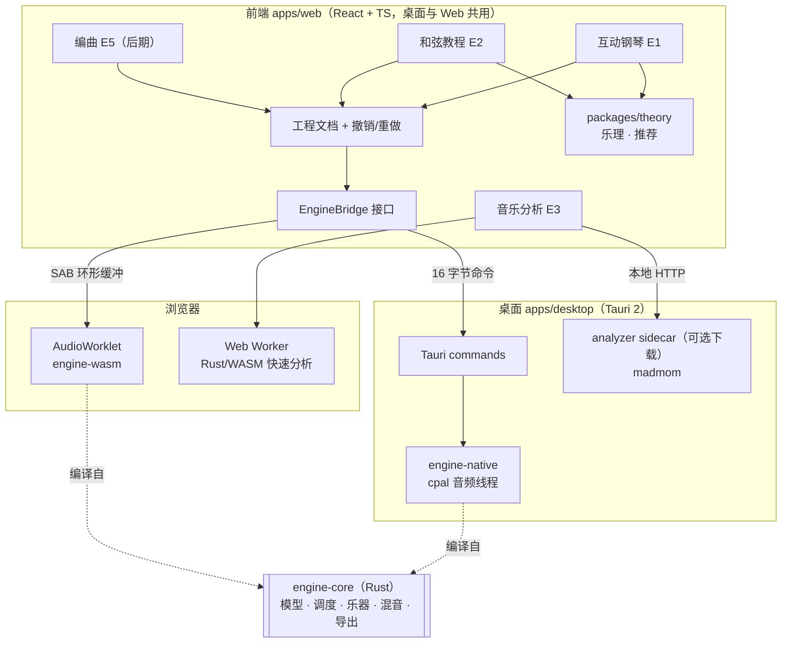

# 架构总览 / Architecture overview

> 状态：Sprint 0 基线（2026-11-16）。修改架构请先写 ADR。

## 一句话

**一份 React 界面 + 一个 Rust 音频内核**。桌面版（Tauri 2，第一优先）中内核以原生代码跑在 cpal 音频线程；Web 版中同一内核编译成 WebAssembly 跑在 AudioWorklet。界面只通过 `EngineBridge` 接口和内核对话，看不出差别。

## 模块职责

| 模块 | 职责 | 不做什么 |
| --- | --- | --- |
| `engine-core` | 工程模型、事件编译、采样级调度、声部池、乐器、混音、效果、离线渲染 | 不碰 I/O、线程、平台 API |
| `engine-native` | cpal 驱动、rtrb 命令队列、引擎热替换、导出 CLI | 不含业务逻辑 |
| `engine-wasm` | C ABI 导出，供 AudioWorklet 调用 | 不用 wasm-bindgen |
| `audio-io` | 解码 WAV/FLAC/MP3/AAC/Vorbis，重采样 | 不播放 |
| `analysis`（S4 新增） | 快速和弦/调/BPM 识别（色度 + 模板 + Viterbi） | 不依赖 AGPL 代码 |
| `packages/engine-web` | AudioWorklet 处理器、SAB 环形缓冲、生成的 TS 类型、Web 版 `EngineBridge` | — |
| `packages/theory` | 和弦/音阶/级数、和弦排序、进行推荐 | 不发声 |
| `apps/web` | 所有界面、国际化、工程文档状态 | 不直接调用 Web Audio |
| `apps/desktop` | Tauri 壳、原生引擎、文件系统、sidecar 管理 | 不含界面代码 |
| `services/analyzer` | 精确和弦/调/BPM 识别 | — |

## 关键约束（来自 Spike 001）

1. `Engine::process()` 零分配、无锁、无 I/O（有测试守护）。
2. 音频路径不调用 libm，保证原生与 WASM 输出逐采样一致；CI 中做一致性比对。
3. 工程 JSON 在主线程编码成字节再发给 AudioWorklet（worklet 里没有 TextEncoder）。
4. `cpal::Stream` 由专属线程持有。
5. Web 部署必须带 `Cross-Origin-Opener-Policy: same-origin` 和 `Cross-Origin-Embedder-Policy: require-corp`。
6. 采样内存按 ADR-0005 的预算执行。

## 数据模型（摘要）

| 实体 | 关键字段 | 定义位置 |
| --- | --- | --- |
| Project | tempo_bpm、master_gain、tracks | `engine-core/src/model.rs` |
| Track | instrument（synth / sampler / drums）、gain、pan、mute、delay_send、clips | 同上 |
| Clip / Note | start_beat；start、length（拍）、pitch、velocity | 同上 |
| SampleZone | sample_id、root/lo/hi note、lo/hi velocity、gain | 同上 |
| Song（分析） | 文件引用、时长、调、BPM、状态、标签、歌单 | `apps/web`（IndexedDB / 桌面 SQLite，待定） |
| ChordEvent | 开始/结束、和弦、级数、置信度、是否手改 | 同上 |

## 决策索引

| ADR | 主题 |
| --- | --- |
| [0001](../adr/0001-rust-audio-core-dual-target.md) | Rust 内核双目标（B 路线） |
| [0002](../adr/0002-monorepo-and-tooling.md) | 单仓库与工具链 |
| [0003](../adr/0003-engine-threading-and-command-protocol.md) | 线程模型与命令协议 |
| [0004](../adr/0004-project-model-and-types.md) | 工程模型、类型共享、编辑策略 |
| [0005](../adr/0005-sample-memory-budget.md) | 采样内存预算 |
| [0006](../adr/0006-chord-analysis-deployment.md) | 和弦识别部署方式 |
| [0007](../adr/0007-licensing.md) | 开源许可证（MIT OR Apache-2.0） |
